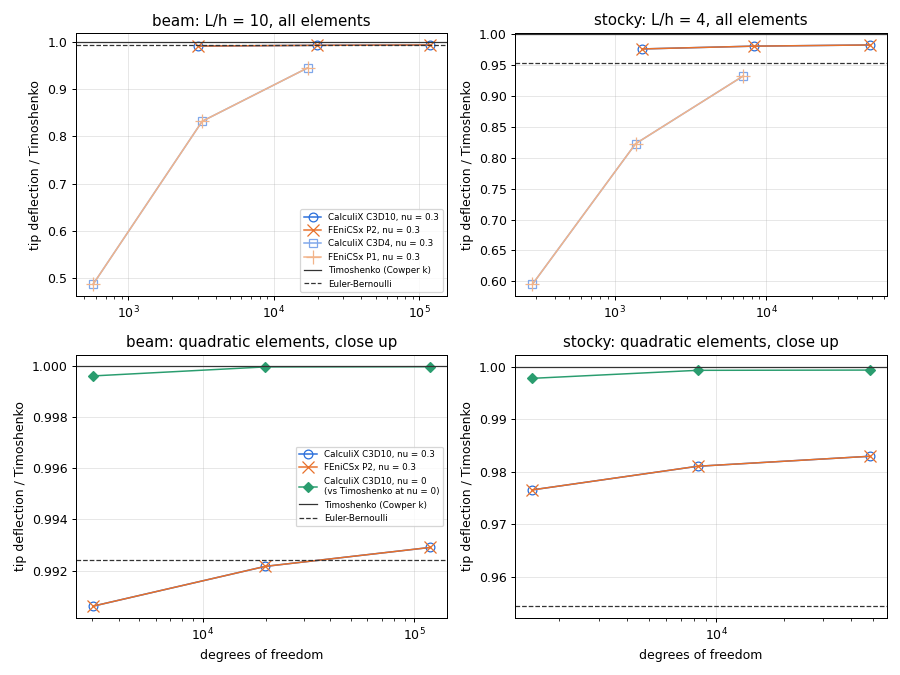
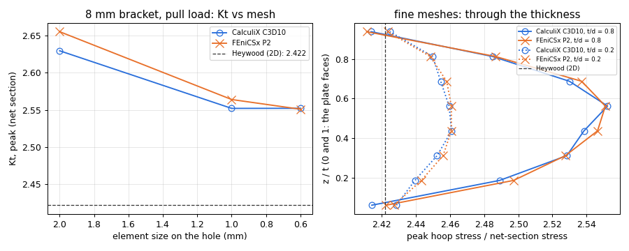

# cad-to-fea

> Personal learning project, built pairing with Claude Code.

[](https://github.com/builtbyshailendra/cad-to-fea/actions/workflows/ci.yml)

One engineering result pushed through five open-source tools and checked against answers known in advance. A steel angle bracket (and two plain cantilevers) is modelled twice from the same parameters, in **CadQuery** and in **build123d**; meshed once with **Gmsh**; solved twice, with **CalculiX** and with **FEniCSx**; and compared with Euler-Bernoulli and Timoshenko beam theory and with Heywood's stress concentration factor for a hole.

Textbook cases only: the geometry, loads and material are made up for the check, not taken from a real product. Every number below comes from a run: the CAD and meshing steps run on my Windows laptop and in CI; CalculiX and FEniCSx run only in CI (GitHub Actions, Ubuntu 24.04), because neither is installed locally.

```text
params.py ──► CadQuery: sketch L profile, extrude, fillet, cut hole ──► STEP ─┐  volume, area, centre of mass,
          └─► build123d: box + box, fillet, cut hole               ──► STEP ─┴─ inertia, bbox: equal to 1e-16
CadQuery STEP ──► Gmsh: named faces, size field at hole and fillet, 10-node tets ──┬─► .msh ──► FEniCSx P2 ──┐ same mesh:
                                                                                   └─► .inp ──► CalculiX C3D10 ┘ same answer
cantilevers ──► Timoshenko (Cowper k), Euler-Bernoulli          bracket hole ──► Heywood Kt = 2 + (1 - d/W)^3
```

## Run it

Locally (Windows or Linux; CadQuery, build123d and Gmsh only):

```bash
pip install -r requirements-ci.txt   # cadquery 2.8.0, build123d 0.12.0, gmsh 4.15.2, numpy, matplotlib, pytest
python scripts/build_geometry.py     # step 1: both CAD models, STEP files, results/geometry.txt (about 10 s)
python scripts/build_meshes.py       # step 2: 10 meshes, results/meshes.txt (about 15 s)
python -m pytest                     # 59 pass, 41 skip here: the CalculiX and FEniCSx tests need CI
```

Generated files go to `out/` (set `CADFEA_OUT` to put them elsewhere; mine are on drive D).

In CI (`.github/workflows/ci.yml`, about 9 minutes):
1. **CadQuery, build123d, Gmsh, CalculiX** on `ubuntu-24.04`: `apt-get install calculix-ccx` (2.21), pip for the rest; steps 1-3 and the tests. Meshes and CalculiX results go to an artifact.
2. **FEniCSx** in the `ghcr.io/fenics/dolfinx/dolfinx:v0.10.0-r1` container (DOLFINx 0.10.0, Gmsh 4.14): step 4 on the same meshes, the remaining tests, `scripts/check_no_skips.py` (every test must have passed in at least one of the two jobs) and step 5, the report. Results go to the `results` artifact.

Each job sets `CADFEA_REQUIRE` to the tools it installed, so a missing tool fails the run instead of quietly skipping tests.

## The models

Units: mm, N, MPa. Steel: E = 210,000 MPa, ν = 0.3.

| Model | Geometry | Fixed | Load |
|---|---|---|---|
| `beam` | 200 × 20 × 20 (L/h = 10) | root face x = 0, all DOFs | 1,000 N in -z, uniform over the tip face |
| `stocky` | 80 × 20 × 20 (L/h = 4) | same | same |
| `bracket` | L-shaped angle: arm 160 long, upright 60 high, both 8 thick, 40 wide; 6 mm fillet in the inner corner; 10 mm hole in the arm at x = 100 | back face of the upright | **shelf**: 200 N in -z on the arm's tip face; **pull**: 10,000 N in +x on the same face |
| `thin` | the bracket in 2 mm plate (t/d = 0.2 instead of 0.8) | same | same (used for the Kt check) |

Tip deflection is read at the centre of the tip face, where Gmsh is made to put a node.

## Step 1: geometry twice

`cadfea/geom_cq.py` sketches the L profile on the XZ workplane, extrudes it symmetrically, fillets the inner corner edge (picked with `NearestToPointSelector`) and cuts the hole with a cylinder that overshoots both faces. `cadfea/geom_b123d.py` builds the same solid a different way: two boxes fused in a `BuildPart`, the corner edge found with `filter_by(Axis.Y).sort_by_distance(...)`, then the same fillet and hole. Both export STEP (millimetres).

Mass properties are computed three ways: each tool's own API, the two STEP files read back with plain OpenCASCADE (`props.step_properties`), and closed-form formulas (`props.analytic`: the L profile, the fillet's spandrel r²(1 - π/4) with its centroid at r(10 - 3π)/(12 - 3π) from the corner, minus the hole).

| Measured (`results/geometry.txt`, same locally and in CI) | |
|---|---|
| Bracket | volume 67,520.708114 mm³, area 20,998.690230 mm², centre of mass (60.760834, 0, 11.417728) mm, 10 faces, 24 edges |
| CadQuery vs build123d, all five properties | largest relative difference 3.5e-16 |
| The two STEP files read back | 6.1e-16 |
| Either tool vs the closed form | 5.8e-16 |
| Sensitivity | a 1 µm change in the fillet radius moves the volume by 1.5e-6, which the test (tolerance 1e-12) catches |

I expected agreement to about 1e-6. It is at rounding level because both libraries call the same kernel (OpenCASCADE 7.9) on exact planes and cylinders, so this checks that my two constructions describe the same solid, not that two kernels agree. The closed form is the independent check.

## Step 2: mesh once

`cadfea/mesh.py` imports the CadQuery STEP into Gmsh and finds the faces by type and position, not by tag: the root face (plane at x = 0), the tip face (plane at x = L), the hole and the fillet (cylinders in known boxes). They become physical groups `FIXED`, `LOAD`, `HOLE`, `FILLET` and `SOLID`. A point is embedded in the tip face so a node sits exactly where deflection is measured. Two Distance → Threshold size fields (one for the hole, one for the fillet), combined with a Min field, shrink the elements near the features. `setOrder(2)` makes 10-node tets whose mid-edge nodes lie on the curved surfaces.

Each mesh is written as `.msh` 4.1 (for FEniCSx) and Abaqus `.inp` (for CalculiX), plus a JSON sidecar with the node sets and the consistent tip-load vector.

| Mesh (CI) | Element size (mm) | Nodes | DOFs | Volume error, straight tets | Volume error, curved tets |
|---|---|---|---|---|---|
| beam coarse / medium / fine | 10 / 5 / 2.5 | 1,010 / 6,579 / 39,626 | 3,030 / 19,737 / 118,878 | 0 | 3e-12 (rounding) |
| stocky coarse / medium / fine | 10 / 5 / 2.5 | 506 / 2,753 / 16,072 | 1,518 / 8,259 / 48,216 | 0 | 3e-12 (rounding) |
| bracket coarse | 8, hole 2, fillet 2 | 6,317 | 18,951 | 3.9e-4 | 4.8e-7 |
| bracket medium | 5, hole 1, fillet 1 | 26,966 | 80,898 | 1.0e-4 | 3.2e-8 |
| bracket fine | 3.5, hole 0.6, fillet 0.6 | 92,883 | 278,649 | 3.8e-5 | 4.3e-9 |
| thin fine | 3, hole 0.4, fillet 1 | 50,193 | 150,579 | 2.2e-4 | 5.5e-8 |

- **Curved elements matter.** Treating the 10-node tets as straight-sided cuts the hole and fillet arcs short; the volume error is 1,000 to 10,000 times larger (computed with Gmsh's Jacobians at Gauss points).
- **Consistent loads.** On a 6-node triangle a uniform traction puts nothing on the corner nodes and a third of the triangle's force on each mid-edge node. The tests check that the vector adds up to the load and that no corner node carries any of it.
- **Abaqus node order.** Gmsh's own 10-node tet lists its last two mid-edge nodes the other way round from Abaqus. Its `.inp` writer reorders them; a test checks every mid-edge node sits mid-edge in Abaqus order (median offset 0) and that Gmsh's order would put them on the wrong edges (median offset over 0.3 of an edge).
- **Not identical across machines.** Same Gmsh 4.15.2, same STEP, same options: the fine beam has 39,702 nodes on Windows and 39,626 in CI. Repeatable on one machine (tested), not across.
- **The two STEP files mesh differently.** Same solid, different face order and orientation in the B-rep: meshing the build123d file gives 6,330 nodes for the coarse bracket against 6,308 from the CadQuery file (locally). So the pipeline meshes one file.

## Step 3: CalculiX

`cadfea/ccx.py` writes a deck that `*INCLUDE`s Gmsh's mesh and adds node sets, `*MATERIAL`/`*ELASTIC`, `*SOLID SECTION`, `*BOUNDARY` (all DOFs of the root face), one `*STEP`/`*STATIC` per load case with `*CLOAD` (the bracket's second step uses `OP=NEW` so the shelf load does not carry over), `*NODE PRINT` of the tip node and the reaction totals to `.dat`, and nodal displacements and stresses to `.frd`. The `.frd` parser reads fixed 12-character columns, because CalculiX writes `1.00000E-03-2.50000E-01` with no space. For C3D4 runs the mid-edge nodes are dropped from the elements and from the node sets.

Reactions balance the applied load in every run, in both solvers: 1,000 N for the beams, 200 N and 10,000 N for the bracket, with the other components below 4e-7 N. The fine bracket (278,649 DOFs, two load cases) took 95 s with CalculiX's default solver (SPOOLES) in the run quoted here, 95-124 s across four CI runs.

## Step 4: FEniCSx

`cadfea/fenics.py` loads the `.msh` into Gmsh and hands the model to `dolfinx.io.gmsh.model_to_mesh`, which keeps the curved geometry and turns the face groups into facet tags. The problem is the weak form ∫ σ(u) : ε(v) dx = ∫ T · v ds(LOAD) on vector P2 Lagrange (the same unknowns as C3D10), u = 0 on the `FIXED` facets, T the load divided by the integrated tip area. MUMPS solves it; CG with algebraic multigrid and the six rigid-body modes as near-nullspace gives the same answer (tested). Stresses are σ(u_h) interpolated into a discontinuous quadratic space at each cell's 10 nodes and averaged at the nodes, the same smoothing CalculiX applies, so one function (`post.feature_stresses`) computes the hole and fillet numbers for both.

The fine bracket took 48 s (two LU solves; 36-48 s across runs) against CalculiX's 95 s.

## Step 5: against theory

### Cantilevers (CI)

| | L/h | Euler-Bernoulli | Timoshenko (Cowper k = 0.850) | CalculiX C3D10, fine | FEniCSx P2, fine | vs Timoshenko |
|---|---|---|---|---|---|---|
| beam | 10 | 0.952381 mm | 0.959667 mm | 0.952856 mm | 0.952856 mm | **-0.71%** |
| stocky | 4 | 0.060952 mm | 0.063867 mm | 0.062777 mm | 0.062777 mm | **-1.71%** |

Both solvers are within the 1-2% I set as the target, but always on the stiff side, and at L/h = 10 the result sits almost on Euler-Bernoulli (+0.05%) instead of on Timoshenko. Before loosening anything I looked for the cause:
- **Not the mesh.** C3D10 converges smoothly (beam: 0.950655 → 0.952146 → 0.952856 mm), and halving the element size changes the answer by 0.07%.
- **Not the solver.** CalculiX and FEniCSx agree to 3e-8 on every beam mesh.
- **The clamp.** A fully fixed root face also stops the steel contracting sideways under the bending stress (Poisson's ratio). Beam theory's clamp only fixes the deflection and the rotation. With ν = 0, nothing contracts and the experiment isolates the effect:

| ν = 0 (CalculiX C3D10, CI) | coarse | medium | fine | Timoshenko, ν = 0 (k = 5/6) |
|---|---|---|---|---|
| beam | 0.957710 | 0.958047 | 0.958054 mm (**-0.004%**) | 0.958095 mm |
| stocky | 0.063098 | 0.063195 | 0.063198 mm (**-0.06%**) | 0.063238 mm |

With ν = 0 both beams land on Timoshenko and well away from Euler-Bernoulli (+0.6% and +3.7% above it). So the tests keep the target tolerances for ν = 0.3 (1% for L/h = 10, 2% for L/h = 4), require the result to be stiffer than Timoshenko, and add a 0.1% check at ν = 0. At L/h = 4 and ν = 0.3, 63% of Timoshenko's shear deflection is still there.

**Element order** (same meshes, tip deflection vs Timoshenko):

| | coarse | medium | fine |
|---|---|---|---|
| beam, C3D10 = P2 | -0.94% | -0.78% | -0.71% |
| beam, C3D4 = P1 | **-51.3%** | -16.8% | -5.5% |
| stocky, C3D4 = P1 | -40.5% | -17.7% | -6.7% |

Linear tets lock in bending: on the coarse mesh the beam is twice as stiff as it should be. CalculiX C3D4 and FEniCSx P1 give the same numbers to all printed digits, as they should: same element, same mesh, same loads.



### Bracket (CI)

**Two solvers, one mesh.** Tip deflection under the shelf load: -0.664070 / -0.665197 / -0.665479 mm (CalculiX, coarse / medium / fine) against -0.664058 / -0.665196 / -0.665479 mm (FEniCSx): 1.8e-5 apart on the coarse mesh, 1.4e-7 on the fine one, against a 1-2% target. On straight-sided tets the two programs solve the identical discrete problem; on the curved tets at the hole and fillet CalculiX integrates with 4 points and FFCx with a higher-degree rule, and that difference shrinks as the elements get smaller.

**Hole Kt under the pull load.** Net-section stress P/((W - d) t) = 41.667 MPa; Heywood's formula gives Kt = 2 + (1 - 0.25)³ = 2.422.

| Kt (peak hoop stress / net-section stress) | hole elements | CalculiX | FEniCSx | vs Heywood |
|---|---|---|---|---|
| 8 mm bracket, coarse | 2 mm | 2.630 | 2.655 | +8.6% / +9.6% |
| 8 mm bracket, medium | 1 mm | 2.552 | 2.564 | +5.4% / +5.9% |
| 8 mm bracket, fine | 0.6 mm | 2.552 | 2.551 | **+5.4% / +5.3%** |
| 8 mm bracket, fine, where the hole meets the faces | | 2.228 | 2.236 | -8.0% / -7.7% |
| 8 mm bracket, fine, mean of 8 bins through the thickness | | 2.494 | 2.498 | +3.0% / +3.1% |
| 2 mm plate (`thin`), fine | 0.4 mm | 2.461 | 2.461 | **+1.6% / +1.6%** |

The 8 mm bracket's peak is 5.4% above Heywood and converged (medium and fine agree to 0.01% in CalculiX). The reason is thickness: Heywood's formula is a plane-stress result, while in a plate whose thickness is 0.8 hole diameters the hoop stress peaks at mid-thickness and drops where the hole meets the faces (the right-hand plot). Make the plate thin and the peak comes down to Heywood: at t/d = 0.2 it is +1.6% (thickness mean +1.0%). The tests check the thin plate to 2.5% and require the 3D pattern for the thick one (faces below Heywood, mid-thickness above, thickness mean within 4%, peak within 7%).



**Not checked against theory** (reported only): the shelf load's peak principal stress is 94.6 MPa at the fillet and 61.9 MPa at the hole's edge on the top face (fine mesh, CalculiX; FEniCSx within 0.2%). A beam-theory estimate of the bending stress where the arm meets the fillet is 68.4 MPa.

Full tables: `results/summary.md`, written by `scripts/report.py` in CI run [45823187626](https://github.com/builtbyshailendra/cad-to-fea/actions/runs/45823187626) (8 min 39 s; 100 tests, each passed in at least one job: 71 in the first, 36 in the second). Everything in `results/` comes from that run.

## What broke, and what I learned

1. **The cantilevers were stiffer than Timoshenko** (-0.71% and -1.71%), and the slender one matched Euler-Bernoulli better. The mesh and the solvers were fine; the fully clamped face restrains the Poisson contraction that beam theory ignores. Setting ν = 0 brought both within 0.07%. A boundary condition is a modelling choice, and "clamped" in 3D is not "clamped" in a beam.
2. **The first hole Kt check failed at +5.4%** against a 5% tolerance. Before touching the tolerance, the through-thickness plot and the thin-plate run showed the excess is the 3D thickness effect (mid-plane up, faces down). The tests now check the thin plate tightly (2.5%), and for the thick plate the pattern plus a 7% bound on the peak.
3. **CalculiX and FEniCSx disagreed by 0.34% on the first `thin` mesh**, which left the fillet at 3 mm elements in 2 mm plate. Strongly curved, coarse 10-node tets are integrated differently by the two programs. Refining the fillet to 1 mm closed the gap to 7e-5.
4. **C3D4 runs reported the C3D10 mesh's DOF count.** The deck writer now returns the number of nodes the elements actually use (5,716 corner nodes of 39,626 on the fine beam).
5. **DOLFINx 0.10 moved things:** `dolfinx.io.gmshio` is now `dolfinx.io.gmsh`, `read_from_msh` returns a `MeshData` tuple, `LinearProblem` needs `petsc_options_prefix`, and `Function.eval` returned a flat array where the first version of the code expected one row per point (the first CI run of step 4 failed on that).
6. **Surface groups in the `.inp`** would have become 2D elements without a section. The `.inp` is written with only the volume group; the node sets come from the sidecar.
7. **Same inputs, different meshes on Windows and Linux.** The README's mesh numbers are from CI, where the solver results come from.
8. **The pip cache never saved** while the first CI runs failed (`actions/setup-python` saves it only after a successful job), so each early run spent about a minute installing.

## Limits

- Linear elastic, small displacements, static loads; no contact, no bolts, no plasticity.
- The bracket's back face is perfectly rigid. A real bolted bracket is held at its bolts, and its stresses near the wall would differ.
- Kt is checked against a 2D formula plus a thickness trend; I did not find an explicit 3D reference value I could verify, so the thick plate's +5.4% is explained by measurement, not by a published number.
- The fillet stress is reported, not checked: there is no textbook chart for this L-bracket corner.
- CalculiX and FEniCSx run only in CI; locally only the CAD and meshing steps run.
- Both CAD tools sit on the same kernel; their agreement does not test OpenCASCADE itself.
- One mesh generator. The meshes differ slightly between Windows and Linux; the solver numbers here are for the CI meshes.
- Peak stresses are nodal averages (extrapolated and smoothed). Another stress recovery would move the peaks a little; Kt converged with this one (medium and fine within 0.01%).

## Layout

| Path | What's in it |
|---|---|
| `cadfea/params.py` | every dimension, load, material and mesh size |
| `cadfea/geom_cq.py`, `cadfea/geom_b123d.py` | the models in CadQuery and in build123d |
| `cadfea/props.py` | STEP read-back with OCP, closed-form properties, comparison |
| `cadfea/mesh.py` | Gmsh: faces by geometry, physical groups, size fields, 10-node tets, consistent loads, `.inp` reader |
| `cadfea/ccx.py` | CalculiX deck, runner, `.dat` and `.frd` parsers |
| `cadfea/fenics.py` | FEniCSx: mesh from Gmsh, weak form, solve, nodal stresses |
| `cadfea/post.py` | hole and fillet stresses, the same code for both solvers |
| `cadfea/theory.py` | Euler-Bernoulli, Timoshenko (Cowper k), Heywood Kt |
| `cadfea/pipeline.py` | build each output once; rebuild when its inputs change |
| `scripts/` | one script per step, `check_no_skips.py`, `report.py` |
| `tests/` | geometry, mesh, CalculiX, FEniCSx and cross-solver tests |
| `results/` | text summaries and plots from the CI run named above |
| `LEARN.md` | the five tools, questions to explain without notes, one hands-on exercise per tool |
